# AIVA V2 Voice Phase 8 — Release Certification

## Decision

**CONDITIONAL GO — authorized DotVoice appointment booking only.** This decision is limited to the audio inbound path that enters `VoiceReadOnlyAivaService` and then uses `AivaV2VoiceConversationAdapter` with a trusted `BookingExecutionContext`. Do not release the generic Web or alternate `AivaV2ConversationService` booking path on the strength of this certification: focused tests reproduce a canonical provider resolution failure because its generic transaction boundary does not carry tenant scope into the kernel. That path must remain disabled/held until separately repaired and tested. No production code or protected business boundary was changed in Phase 8.

This is a code-and-test certification, not a production rollout approval. Production smoke checks and rollback criteria are below.

## Authorized runtime path

```mermaid
flowchart LR
  A[DotVoice media callback] --> B[CommunicationTestService inbound audio]
  B --> C[VoiceOrchestratorService STT]
  C --> D[VoiceReadOnlyAivaService identity and policy]
  D --> E[AivaV2VoiceConversationAdapter]
  E --> F[logical context and bounded recognition]
  F --> G{deterministic decision?}
  G -- yes --> I[validated contextual operation]
  G -- no --> H[bounded AI evidence proposal]
  H --> I
  I --> J[AivaV2TransactionalKernel and typed effects]
  J --> K[canonical provider and availability tools]
  K --> L[context-bound confirmation]
  L --> M[VoiceBookingExecutionService]
  M --> N[AppointmentBookingApplicationService]
  N --> O[AppointmentService]
  O --> P[durable appointment and idempotency receipt]
  P --> Q[completed outcome and reconciliation]
  Q --> R[typed Voice response intent]
  R --> S[AivaV2VoiceResponseRenderer]
  S --> T[session presentation mode and matching TTS locale]
  T --> U[DotVoice playback]
```



The path is reflected in `CommunicationTestService`, `VoiceReadOnlyAivaService`, `AivaV2VoiceConversationAdapter`, `VoiceBookingExecutionService`, and the existing booking application/domain services. The shared gateway/kernel path is still present for Web and the alternate `VoiceOrchestratorService.processAivaV2FinalTranscript → AivaV2VoiceTurnConnector → AivaV2ConversationService` connector; it is not equivalent to the authorized DotVoice path.

## Certified scope

Authorized DotVoice appointment booking with transcript-level English, Hindi, and Hinglish turns; canonical provider binding and ambiguity; date/daypart and time refinement; retained availability pagination; displayed-slot selection; guarded provider switch; context-bound confirmation/decline/change; stale-slot and generic failure distinction; durable success, replay/idempotency, post-session-write reconciliation, completed repeat, and presentation/TTS locale. Tests exercise inbound communication service plumbing with controlled STT transcripts; they do not measure acoustic recognition quality.

## Excluded from this decision

- Web/generic conversation orchestration and alternate Voice connector migration.
- Reschedule and cancellation redesign.
- Acoustic STT model quality, carrier behavior, and real-phone network quality.
- Phase 7 legacy read-only renderer cleanup.
- Production deployment or rollout.

The generic provider-scope defect is a real defect in excluded shared channels, not an accepted baseline exception for those channels. Those channels remain release-blocked.

## Conversation certification matrix

| Scenario / test evidence | Initial context and transcript | Expected decision and response | Allowed / forbidden effects | Result |
|---|---|---|---|---|
| Hindi happy path — `AivaV2VoiceDotVoiceInboundPathTest.finalHindiSttBookingPhrasesStayBookIntentThroughRealDotVoiceInboundEntryWithBookingPolicyEnabled` and related inbound tests | Empty authorized call; doctor, `कल`, evening, ordinal, `हाँ कर दो` | Canonical provider → date → slots → selected displayed slot → confirmation → localized success | Canonical resolution, required availability, one authorized execution; no duplicate mutation | Passed in DotVoice suite (51/51) |
| Hinglish / English happy path | Equivalent provider/date/daypart/slot/confirm transcripts | Same contextual decisions; language-specific rendering | Same booking boundary; no cross-language state reset | Existing inbound and language adapter coverage passed; full triplet sequence not separately added in Phase 8 |
| Slot→plot / pagination | AWAIT_SLOT, `और प्लॉट बताओ` / `next slot batao` | SHOW_MORE or slot clarification; retained snapshot only | No provider discovery, AI, availability reload, or mutation | Covered by inbound adapter tests; suite passed |
| Provider ambiguity | Canonical Ravi candidates; `Ravi doctor`, then displayed ordinal | Persisted candidate clarification; ordinal resolves only stored candidates | No outside-candidate discovery or provider overwrite | Existing Phase 1 inbound tests passed |
| Provider switch | Active Amit, Ravi request, YES/NO; same-provider reaffirmation | Identity then switch confirmation; YES handoff/transition, NO restores Amit | No binding change while pending; no mutation | Existing Phase 3 inbound tests passed |
| Confirmation adversarial cases | AWAIT_CONFIRMATION: yes, no, unclear, repeat, change slot/date/daypart, another provider | One bounded action; only valid yes executes | No mutation for ambiguity/decline/change; old binding invalidated on changes | Existing Phase 5A/5B inbound coverage passed |
| Stale / generic execution error | Prepared slot becomes unavailable, then yes; separate generic error injection | Stale-specific recovery versus generic failure | One attempt, no automatic retry; no appointment on stale | Existing true-stale inbound coverage passed |
| Durable success and replay | Commit then injected session finalization failure; replay/status/repeat | Receipt reconciliation and completed summary | One durable appointment; no second mutation | Existing Phase 5C inbound coverage passed |
| Session read failures | NOT_FOUND / UNAVAILABLE / CORRUPT | Distinct safe outcomes; no blind rebooking on unavailable/corrupt | No new booking without trusted valid state | `AivaV2SessionStoreReadFailureTest` passed 3/3 |
| Tenant/session isolation | Same call identifier across tenants; active draft, confirmation, completed outcome and provider clarification | Independent tenant-prefixed sessions and canonical provider bindings | No provider/draft/confirmation/outcome/receipt reuse | Dedicated authorized DotVoice same-call tests and Redis roundtrip added in Phase 8B; shared-service vertical test remains blocked by AIVA-V2-REL-001. |
| Long conversation, 15–25 turns | One 21-turn evolving authorized DotVoice call with detours and corrections | No context drift | No reset, wrong booking or duplicate mutation | Dedicated inbound scenario added in Phase 8B; result recorded below. |

## Reassessment of the 12 accepted failures

Each identity was rerun in the broad selector context; the targeted selection is in `/tmp/aiva-phase8-reassessed.log`, and the expanded focused selection is in `/tmp/aiva-phase8-focused.log`. Phase 8 found two outdated expectations that are now corrected in tests, multiple real failures in the generic shared path, and the isolated reschedule failure. An intermediate focused run reported 329 tests, 9 assertion failures and 1 error; after restoring the direct-kernel test to assertion form, the Docker-enabled authoritative run completed with 10 assertion failures and no errors. These are pre-existing paths/identities, not new product failures caused by Phase 8 source changes.

| Original failure | Expected → actual / root cause | Classification | DotVoice / booking safety | Disposition |
|---|---|---|---|---|
| `AiAivaV2ConversationDecisionGatewayTest.activeBookingContextIncludesBoundedDraftValuesAndPendingProviderFieldForSemanticSpecialty` | Previously expected AI invocation for a specialty phrase; exact specialty is deterministically understood in current context, so AI is not called. Test changed to unresolved “For routine health concerns” and asserts bounded AI fallback. | STALE_TEST_EXPECTATION | No / no | Fixed test expectation; targeted test passes. |
| `AivaV2ActiveBookingFollowUpRegressionTest.pendingProviderFieldTreatsShortDoctorPhrasesAsAuthoritativeResolverCandidates` | Expected shared gateway to remove “Talk”; actual shared path retains raw phrase. Voice cleanup is intentionally in `DoctorNameNormalizer`/authorized adapter. | STALE_TEST_EXPECTATION | No / no | Updated assertion to raw shared-gateway evidence; Voice normalization remains tested at its owner. |
| `AivaV2ActiveBookingFollowUpRegressionTest.providerResolutionAdvancesWorkflowWithoutLosingRequestedDate` | Direct compatibility kernel path lacks trusted tenant scope; canonical adoption cannot happen. Null-scope path is not the authorized Voice path. | LEGACY_COMPATIBILITY_PATH | No / no | Deferred with generic shared-path issue; do not weaken canonical resolution. |
| `AivaV2LanguageBoundaryVerticalTest.fullBookingConversationUsesRealAdapterGatewayKernelToolsAndRendererInAllStyles` | Expected NEED_DATE, actual PROVIDER_NOT_FOUND; generic `AivaV2ConversationService → AivaV2TransactionalExecutionBoundary → kernel` omits tenant scope. | NON_DOTVOICE_CHANNEL | No / potential wrong-provider prevention correctly fails closed | Hold Web/shared path; fix tenant propagation under its own approved scope. |
| `AivaV2LanguageBoundaryVerticalTest.rescheduleConversationUsesRealServiceToolsAndStructuredResponsesInAllStyles` | Expected RESCHEDULE_AVAILABLE_SLOTS, actual RESCHEDULE_NO_MORE_SLOTS; reschedule fixture/behavior. | RESCHEDULE_OUT_OF_SCOPE | No / no for new booking | Defer; do not change reschedule semantics in Phase 8. |
| `AivaV2LanguageBoundaryVerticalTest.serviceSessionKeysIsolatePatientConversationTenantAndPresentation` | Expected NEED_DATE, actual PROVIDER_NOT_FOUND before tenant-isolation assertions; same shared-path missing tenant scope. | NON_DOTVOICE_CHANNEL | No / isolation assertion is not reached | Existing session key includes tenant/patient/conversation. Still require a direct seeded-session isolation test before certifying generic channel. |
| `AivaV2LanguageBoundaryVerticalTest.standaloneControlTurnsKeepEstablishedConversationPresentationThroughService` | Expected AVAILABLE_SLOTS, actual NEED_PROVIDER; generic service fixture starts without canonical provider due scope omission. | NON_DOTVOICE_CHANNEL | No / no | Hold generic service path; not a rendering regression. |
| `AivaV2PocCertificationTest.callToBookNeverInvokesAvailabilityOrBooking` | Expected CALL_TO_BOOK, actual PROVIDER_NOT_FOUND; same tenant-scope omission in generic path. | NON_DOTVOICE_CHANNEL | No / no | Hold generic path. |
| `AivaV2PocCertificationTest.englishHappyPathMoreSlotsContextQuestionAndDuplicateConfirmation` | Expected SLOT_CHOICES, actual PROVIDER_NOT_FOUND; same generic provider adoption failure. | NON_DOTVOICE_CHANNEL | No / no | Hold generic path. |
| `AivaV2PocCertificationTest.hindiAndEnglishConfirmationHaveIdenticalKernelSemantics` | Expected CONFIRMATION_REQUIRED, actual CLARIFICATION; setup cannot establish canonical provider through the shared path. | NON_DOTVOICE_CHANNEL | No / no | Hold generic path. |
| `AivaV2PocCertificationTest.hinglishDateCorrectionRetainsProviderAndInvalidatesSlot` | Expected provider display value, actual null; provider never canonically adopted in shared path. | NON_DOTVOICE_CHANNEL | No / no | Hold generic path. |
| `AivaV2PocCertificationTest.sameConversationIdentifierCannotReuseDraftAcrossTenantScopes` | Expected first tenant provider, actual null before isolation assertion; same provider-resolution failure. | NON_DOTVOICE_CHANNEL | No / isolation proof incomplete | Do not count this as passing tenant isolation; dedicated assertion remains required. |

The targeted gateway and raw-evidence stale expectations now pass after expectation correction. The remaining provider-scope and reschedule identities remain failures. The intermediate focused output of 329 tests / 9 failures / 1 error / 12 skipped was superseded by the unchanged Docker-enabled authoritative selector result of **578 tests / 568 passed / 10 assertion failures / 0 errors / 0 skipped**. The selector includes excluded shared-channel cases, so its failures do not establish a DotVoice defect; the canonical tenant-scope issue remains a release blocker for those shared channels.

## Failure injection and safety evidence

| Failure | Expected safe behavior | Evidence / result |
|---|---|---|
| STT ambiguity / doctor-like corruption | Preserve booking and clarify | Phase 1/2 DotVoice tests in 51-test inbound suite passed |
| Provider ambiguity | Clarify among tenant-canonical persisted candidates | Existing inbound provider ambiguity tests passed |
| Empty availability / exhausted page | Contextual recovery; no implicit future-date search | Existing slot-context coverage passed |
| Stale slot | One authorized attempt, stale-specific response, no appointment/retry | True stale inbound test passed in DotVoice suite |
| Generic execution error | Not mislabeled stale; no automatic mutation retry | Existing injected generic-error test passed |
| Session finalization write failure after durable success | Receipt reconciliation; one appointment | Existing post-commit failure/replay test passed |
| Session read unavailable/corrupt/not found | Distinguishable safe outcomes | Read-failure suite passed 3/3 |
| Duplicate/replayed turn | Receipt/turn idempotency; one appointment | Existing duplicate YES/replay inbound tests passed |
| Incompatible AI proposal | Reject and preserve context | Kernel/adapter regression suites passed |
| Unauthorized / mismatched booking context | No mutation | Voice execution suite 6/6 and policy resolver 14/14 passed |
| Cross-tenant reuse | Must not reuse state or receipt | Existing keying/security design reviewed; specific generic isolation test does not reach assertion. Release remains conditional until explicit authorized inbound cross-tenant test passes. |

## Verification executed

Expanded focused command (Docker was not rebuilt or restarted):

```text
mvn -pl backend/api/api-bff -am test -Dtest=AivaV2VoiceDotVoiceInboundPathTest,AivaV2VoiceBookingExecutionTest,AivaV2VoiceConversationAdapterTest,AivaLanguageAdapterTest,AivaV2VoiceTurnConnectorTest,AivaV2LanguageBoundaryVerticalTest,AivaV2PocCertificationTest,AivaV2ActiveBookingFollowUpRegressionTest,AivaV2DistributedSessionStoreTest,AivaV2SessionProjectionSerializationTest,AivaV2SessionStoreReadFailureTest,AivaV2SpringWiringTest,AivaV2LogRedactionTest,AivaV2TransactionalKernelTest,VoiceBookingExecutionServiceTest,VoiceTransactionPolicyResolverTest,PatientPortalServiceTest,AppointmentServiceTest,AivaResponseRendererTest
```

Key passing classes in that run: DotVoice inbound 51/51; authorized adapter 74/74; language 32/32; transactional kernel 42/42; voice booking execution 6/6; booking execution service 5/5; policy resolver 14/14; session read failure 3/3; session projection serialization 3/3; wiring 2/2; log redaction 1/1; Patient Portal 42/42; shared renderer 12/12; alternate connector 2/2. Distributed Redis tests were skipped because they require the separately provisioned Testcontainers environment. The combined selection also exposed the listed shared-path/reschedule failures.

The Phase 8 pre-Phase-8B unchanged authoritative selector completed at **578 tests / 568 passed / 10 assertion failures / 0 errors / 0 skipped**. Two of the original 12 identities pass after their stale expectations were corrected. The other ten identities remain: one direct generic-kernel compatibility expectation, four generic vertical conversation failures (one of these is reschedule), and five generic POC conversation failures. Testcontainers availability boundary passed 1/1 and transactional reliability passed 9/9 on the Docker-enabled rerun. The Phase 8B broad-selector result is pending below. No new product behavior was changed in Phase 8B. The shared-channel provider-scope issue is real; authorized same-call tenant isolation is now separately exercised.

## Security, privacy, and known limitations

- Canonical tenant provider adoption remains fail-closed; public discovery is not transactional provider capability.
- DotVoice authorization continues through the existing execution-context factory and transaction policy; spoken confirmation is not authorization.
- Session keys and execution/idempotency correlation are scoped through existing trusted tenant/patient/call context; no new ledger or store was added.
- Operational logs use IDs/hashed conversation identifiers and do not intentionally log full transcripts, phone numbers, clinical details, or serialized sessions. Review existing legacy `AIVA_V2_VOICE_FLOW` logs before broad production enablement; some legacy diagnostic fields include provider display name and utterance-derived facts.
- Completed booking reconciliation trusts the existing idempotency/receipt path. No alternate mutation or idempotency mechanism was added.
- Phase 8B now certifies the dedicated 21-turn transcript-level flow, same-call authorized DotVoice tenant isolation, and Redis session-key roundtrip. Physical acoustic/telephony STT and TTS quality remain outside this transcript-level certification.

## Remaining issue classification

| Priority | Issue | Action |
|---|---|---|
| P1 release blocker for shared channels | Generic transaction boundary loses tenant scope before canonical provider resolution; tests fail closed as `PROVIDER_NOT_FOUND`. | Keep Web and alternate Voice booking held pending trusted tenant propagation and channel-specific isolation regression tests. |
| P2 operational follow-up | Legacy `AIVA_V2_VOICE_FLOW` diagnostics include provider display names and utterance-derived provider evidence; new Phase 7 response/decision traces use IDs/presence and hashed correlation. | Review/trim legacy fields before broad production traffic; no patient phone, transcript body, clinical detail, or full session serialization is intentionally logged by the new response traces. |
| OUT_OF_SCOPE | Physical acoustic STT/TTS quality, rescheduling/cancellation redesign, full shared Web/alternate Voice migration. | Certify separately; keep affected booking channels held where specified. |
| OUT_OF_SCOPE | Rescheduling failure in the vertical test. | Track separately; no Phase 8 reschedule redesign. |

## Production smoke-test plan and rollback criteria

Before any limited DotVoice enablement, use a non-production tenant and authorized test patient to exercise one Hindi, one Hinglish, and one English booking; verify canonical provider/date/slot in the durable appointment; confirm repeat and duplicate-turn behavior; verify no booking on decline, ambiguity, unauthorized calls, and stale slot; inspect response/TTS locale and redacted decision/response correlation. Check that booking count and idempotency receipt agree.

Immediately disable the Voice booking feature flag / route traffic back to the prior supported booking channel if any wrong-tenant/provider/slot booking, duplicate durable appointment, authorization bypass, inability to reconcile post-commit success, session context leak, or unlocalized/misleading success response is observed. Do not use a code rollback that removes idempotency receipts or changes durable booking records; preserve evidence for reconciliation.

## Phase status

Phase 8 was incomplete before Phase 8B. Phase 8B closes the authorized DotVoice cross-tenant and long-conversation test gaps. It does not certify Web/shared or alternate Voice booking; those channels remain held under `AIVA-V2-REL-001`. The conditional release decision and effective-config requirements are recorded below. No deployment or Phase 9 work is authorized by this document.

## Phase 8B — cross-tenant and long-conversation certification

## Release configuration remediation — shared channels fail closed

### Deployment source and precedence

The checked-in production deployment candidate is `local/docker-compose.prod.yml`
with `local/.env.prod-jeevanam`, API profile enabled. The repository has no
production deployment wrapper; therefore the command actually used by the
production operator and the live production API environment remain **UNKNOWN**.
The checked-in UAT entry point is `scripts/deploy-uat-arogia.sh`, which combines
`local/docker-compose.yml` and `local/docker-compose.uat.yml` and loads
`local/.env.uat-arogia` (that secret-bearing runtime file is not present in the
repository). The production API container receives the production env file,
then Compose `environment` entries override matching env-file values. Spring
environment properties override `application.yml` placeholders; clinic
overrides take precedence over tenant overrides, then global operator/default
policy values.

| Property | application fallback | Compose fallback | production env candidate | deployment override | live production API | tenant/clinic override | final production value |
|---|---|---|---|---|---|---|---|
| `AIVA_V2_ENABLED` | false | false | unset | unknown | unknown | not applicable | candidate resolves false; live value unknown |
| `VOICE_AIVA_V2_ENABLED` | false | false | unset | unknown | unknown | not applicable | candidate resolves false; live value unknown |
| `AIVA_VOICE_BOOKING_ENABLED` | false | false | unset | unknown | unknown | supported by policy maps; none configured here | candidate resolves false globally; target tenant must be configured explicitly |
| `AIVA_VOICE_GUEST_BOOKING_ENABLED` | false | false | unset | unknown | unknown | supported by policy maps; none configured here | candidate resolves false globally; guest booking is not required by certified authorized flow |

No production values were read from a live target API. The previously inspected
local container was not modified or restarted. Its former values do not establish
production state.

### Effective gates and independence

`AIVA_V2_ENABLED=false` makes the Web/shared `AivaV2Controller` bean absent at
startup (`@ConditionalOnProperty`), so the transactional HTTP route is not
registered. `VOICE_AIVA_V2_ENABLED=false` is bound to `VoiceTestProperties` and
prevents `VoiceOrchestratorService` from dispatching final transcripts to
`AivaV2VoiceTurnConnector` / `AivaV2ConversationService`. The authorized DotVoice
inbound path instead calls `VoiceReadOnlyAivaService` directly and uses
`VoiceTransactionPolicyResolver`, a trusted `BookingExecutionContext`, and the
authorized adapter. It does not consult either shared-channel flag.

Shared channel defaults are now fail closed in `application.yml`, local/UAT/prod
Compose, and the UAT example env file. `VoiceTestProperties` also defaults its
alternate connector switch to false. The production env candidate leaves these
values unset. Compose explicitly resolves both shared switches false, global
booking false, guest booking false, and OTP required true. Explicit true values remain possible as opt-ins; they are not
approved while `AIVA-V2-REL-001` is unresolved.

The policy resolver supports clinic and tenant maps, in clinic → tenant → global
precedence. A test proves one tenant can be enabled while another remains off in
the same process. The production env candidate has no target tenant/clinic override,
and the target tenant ID/config source was not supplied; intended-tenant-only
enablement is therefore **not yet proven**. The certified DotVoice flow does not
depend on guest booking; guest policy remains disabled by default.

### Startup capability visibility

The API logs a single non-sensitive `AIVA_V2_CAPABILITIES` startup record with
shared Web, alternate Voice, global DotVoice booking, guest booking, and the
availability of tenant/clinic override support. It excludes tenant IDs, patient
data, and secrets. Effective per-tenant authorization remains a per-call policy
decision and is not inferred from that global startup summary.

### Rollback procedure

To disable authorized DotVoice booking, set global `AIVA_VOICE_BOOKING_ENABLED=false`
and remove/disable any matching tenant or clinic `booking-enabled: true` override.
If guest registration is separately active, also set
`AIVA_VOICE_GUEST_BOOKING_ENABLED=false`. Apply through the deployment’s normal
configuration update and recreate/restart the API so Spring rebinds startup
properties; no image rebuild is required. This disables Voice transaction
booking while leaving unrelated clinic services running. Expected API restart
downtime depends on the deployment’s rolling/replacement procedure and is not
verified here. No rollback action was executed.

### Configuration verification status

Configuration matrix expectations are covered by route/policy tests: both shared
flags off removes the Web route and blocks alternate V2 dispatch; an authorized
DotVoice inbound booking still works with alternate V2 off and its booking policy
enabled; per-tenant policy overrides isolate enablement. Explicitly enabling
either shared flag makes its corresponding defective path reachable and is
rejected for release. The live deployment matrix is not certified because no
production API runtime or resolved target tenant override was available.

**Release configuration gate remains FAIL / NO-GO** until the intended production
API is inspected after configuration, both shared flags are observed false, the
target tenant is explicitly authorized while other tenants remain disabled, and
the negative/positive channel tests are run against that resolved configuration.

### Remediation verification

The exact checked-in production Compose candidate (`local/docker-compose.prod.yml`
with `.env.prod-jeevanam`, `api` profile) and UAT candidate (base + UAT Compose
with the UAT example env file) both resolve to:

```text
AIVA_V2_ENABLED=false
VOICE_AIVA_V2_ENABLED=false
AIVA_VOICE_BOOKING_ENABLED=false
AIVA_VOICE_GUEST_BOOKING_ENABLED=false
AIVA_VOICE_OTP_REQUIRED=true
```

This is candidate configuration output, not a live production observation. No
production env file was edited; its booking/channel variables remain unset and
are supplied by fail-closed Compose defaults. No containers were restarted.

Focused tests after the changes: `AivaV2VoiceDotVoiceInboundPathTest` 55/55,
`AivaV2SpringWiringTest` 3/3, `VoiceOrchestratorServiceTest` 24/24,
`VoiceTransactionPolicyResolverTest` 15/15, and
`VoiceCapabilityConfigurationDefaultsTest` 2/2. The WebSocket handler suite is
13/13 after its resume-session fixture explicitly opts into V2. The authorized inbound success
test executes with alternate Voice V2 off; the Web wiring test confirms the
controller is absent with the shared flag off; the alternate Voice test confirms
the shared connector is not called when its V2 flag is off. Tenant map binding
tests prove Tenant A can be enabled while Tenant B remains disabled. Architecture
validation passes.

The authoritative Phase 8 selector after production-source changes completed at
**336 selected tests / 326 passed / 10 assertion failures / 0 errors / 0 skipped**
(summed from the selected test-class reports). The ten failure identities are unchanged: five in `AivaV2PocCertificationTest`, one
in `AivaV2ActiveBookingFollowUpRegressionTest`, and four in
`AivaV2LanguageBoundaryVerticalTest`. They remain the already classified shared
provider-scope/legacy compatibility and reschedule failures; no new failing test
identity was introduced. The final additional focused assertions were test-only
and passed. `git diff --check` and architecture validation pass.

The target tenant's production override and the actual API process environment
remain unknown. Therefore the repository defaults now fail closed, but the
release configuration gate is still **FAIL / NO-GO** pending live deployment
evidence and the intended tenant authorization entry.

### Channel separation and known shared-path defect

Authorized DotVoice enters `CommunicationTestService.processInboundFirstUtterance` and delegates to `VoiceReadOnlyAivaService.continueTurn` / `executeVoiceBookingTurn`, which calls `AivaV2VoiceConversationAdapter.prepareAuthorizedVoiceBookingTurn`. The adapter obtains the trusted tenant from `AivaExecutionContext`, uses `VOICE|{tenantId}|{sessionId}` as the session key, and calls `AivaV2TransactionalExecutionBoundary.resolveVoiceBookingProvider(tenantId, evidence)` before adoption. Its authorized execution also verifies tenant, patient, call, session, interaction and policy bindings. It does not call `AivaV2ConversationService`.

The generic Web entry (`AivaV2Controller → AivaV2ConversationService`) and alternate Voice connector (`VoiceOrchestratorService.processAivaV2FinalTranscript → AivaV2VoiceTurnConnector → AivaV2ConversationService`) use the shared decision/kernel route. That route currently loses trusted tenant scope before canonical provider adoption and fails closed as `PROVIDER_NOT_FOUND`. This is a real channel defect, not fixture drift:

**AIVA-V2-REL-001 — Shared booking orchestration loses trusted tenant scope before canonical provider adoption.** Severity: P1 release blocker for Web/shared and alternate-Voice booking: those booking journeys fail closed as `PROVIDER_NOT_FOUND`. No authorized DotVoice impact was found in the traced route or dedicated inbound tests. The affected channels remain held until trusted tenant propagation and their own cross-tenant tests pass.

The code has independent gates. Web/shared V2 is gated by `aiva.v2.enabled` (`AIVA_V2_ENABLED`, controller condition); alternate Voice V2 is gated by `voice.aiva-v2-enabled` (`VOICE_AIVA_V2_ENABLED`); DotVoice booking execution is governed separately by the Voice transaction booking policy (`AIVA_VOICE_BOOKING_ENABLED` plus tenant/clinic overrides). A DotVoice-only conditional release requires deployment evidence that the first two effective settings are `false` while the authorized DotVoice policy is intentionally enabled. No new entitlement or routing layer was added. Read-only behavior remains subject to its existing controls.

### Added isolation evidence

`AivaV2VoiceDotVoiceInboundPathTest` now reuses the same call-like identifier across two tenants and exercises tenant A active draft/availability, tenant B affirmative input and independent draft, tenant A pending confirmation, tenant B affirmative replay, tenant A success, and tenant B status/repeat. The assertions check tenant-prefixed session keys, patient/provider/date/availability/confirmation/completed outcome preservation, zero Tenant B mutation, and no receipt/result transfer. A separate provider-ambiguity test persists canonical candidates in Tenant A and verifies Tenant B cannot answer or observe them. `AppointmentBookingApplicationServiceTest` verifies a reused execution key/fingerprint maps to distinct tenant/patient receipt scopes. `AivaV2DistributedSessionStoreTest` persists the same DotVoice call identifier under two `VOICE|tenant|call` Redis keys and reloads both through a second store instance; provider and tenant identities remain distinct.

### Long conversation evidence

The inbound suite now includes one evolving **21 patient-turn** Hinglish/Hindi booking conversation. It exercises repeated booking language during date collection, unclear date recovery, date and daypart collection, retained-snapshot pagination, repeat/interruption, ambiguous provider identity, provider switch request and decline, displayed ordinal selection, confirmation summary repeat, ambiguous confirmation, explicit confirmation, duplicate YES, completed status and repeat. It asserts per-turn tenant, patient, presentation mode, draft identity, provider/date continuity, pending clarification/switch/confirmation, availability identity/offset, completed outcome, transcript sequence, cumulative availability behavior, no semantic AI and exactly one booking mutation. Slot selection performs one canonical availability revalidation as part of confirmation preparation; repeat and pagination themselves do not reload availability. The test does not claim exhaustion when undisplayed slots remain.

Turn-level logs in the test harness carry the accepted action/result and response intent. Test assertions verify one inbound diagnostic for each patient transcript; production decision and response traces share the hashed call/conversation identifier and turn ID. This certification does not assert a one-to-one appender-level log count because the current test harness captures returned inbound diagnostics, not Logback events.

| Turn | Patient transcript | Expected/observed decision and context after turn |
|---:|---|---|
| 1 | `मुझे डॉक्टर अमित वर्मा का appointment चाहिए` | Canonically bind Amit; retain draft and ask for date (`AWAIT_DATE`). |
| 2 | `appointment book karna hai` | Refine missing date; same draft/provider, no restart. |
| 3 | `xyz` | Contextual date clarification; provider and draft retained. |
| 4 | `कल` | Set booking date and load availability for the selected provider. |
| 5 | `फिर से बताओ` | Repeat current collection prompt; no provider/date reset. |
| 6 | `शाम में` | Apply evening preference and show available slots. |
| 7 | `और प्लॉट बताओ` | Context-bounded `SHOW_MORE`; retained availability identity, offset advances, no AI. |
| 8 | `repeat` | Repeat current slot/confirmation context; no availability reload. |
| 9 | `second one` | Select only a displayed canonical slot; canonical preparation revalidation occurs once; pending confirmation created. |
| 10 | `कौन सा time था?` | Repeat provider/date/time confirmation summary; binding retained. |
| 11 | `repeat` | Same confirmation summary and binding; no mutation or reload. |
| 12 | `Ravi doctor ka appointment chahiye` | Store Ravi Mehta/Ravi Sharma canonical candidates and clarify identity; Amit remains active. |
| 13 | `Ravi Mehta` | Resolve within persisted candidates; request provider-switch confirmation, without replacing Amit. |
| 14 | `नहीं` | Decline switch; Amit draft, availability and pending booking confirmation restored. |
| 15 | `repeat` | Repeat Amit confirmation summary; no state change. |
| 16 | `शायद` | Ambiguous confirmation; ask a bounded confirmation question, no execution. |
| 17 | `हाँ कर दो` | Execute current authorized confirmation once; store completed outcome. |
| 18 | `हाँ कर दो` | Completed-booking context wins; no second mutation. |
| 19 | `booking ho gayi?` | Return completed status from the stored outcome. |
| 20 | `repeat` | Repeat completed booking summary. |
| 21 | `कौन सा time book हुआ?` | Return completed time/provider details; outcome remains unchanged. |

The test records a projection after each patient turn and checks tenant, patient, unchanged presentation mode, draft identity/provider/date while active, slot page identity and offset, clarification/switch/confirmation state at transition points, completed outcome after success, and exactly one durable mutation.

### Failure-injection disposition

| Case | Tested in current certification | Safe result / release impact |
|---|---|---|
| STT/context ambiguity | Yes | Context retained and bounded clarification; no unsafe booking. |
| Provider ambiguity | Yes | Tenant-canonical candidates retained; second tenant cannot select them. |
| Empty availability / exhausted slots | Yes | Contextual recovery; exhaustion does not itself search a later date. |
| True stale slot | Yes (prior Phase 5B inbound test) | One execution attempt, no durable appointment, stale-specific recovery. |
| Generic booking failure | Yes (prior Phase 5B test) | Not mislabeled stale; no automatic mutation retry. |
| Session finalization failure after durable success | Yes (prior Phase 5C test) | Receipt reconciliation returns the existing booking. |
| Session unavailable / corrupt / not found | Yes (prior session-store tests) | Distinct safe outcomes; unavailable/corrupt does not become a new booking session. |
| Duplicate turn / replay | Yes | One appointment; replay reconciles existing outcome. |
| Incompatible AI proposal | Yes (prior adapter/kernel tests) | Rejected before unsafe operation. |
| Authorization failure / binding mismatch | Yes (prior execution and policy suites) | No mutation. |
| Cross-tenant active draft/confirmation/outcome | Yes (new same-call DotVoice test) | Tenant B remains independent; Tenant A projection is unchanged. |
| Cross-tenant durable receipt | Yes (application-scope unit test and repository tenant-key contract) | Tenant/patient scopes differ for identical execution key and fingerprint. |

### Performance observation

This is not a production latency benchmark. The 21-turn method completed in approximately **0.20 seconds** in the test harness (about 10 ms per turn), with mocked STT, provider/availability and TTS dependencies; this includes adapter/context, kernel/effect and response creation, but excludes real network and acoustic latency. Deterministic path assertions verify no AI on supported controls; the ambiguous provider turn performs bounded canonical candidate lookup. The harness exposes aggregate availability/provider call counts, not independent adapter-versus-renderer timings, so a production-like per-component breakdown remains an operational smoke measurement. No SLA is inferred from test timing.

### Production smoke checklist

After deployment approval (not performed here), use a non-production tenant and authorized patient:

1. Place a DotVoice call and verify the resolved tenant/call binding in redacted logs.
2. Identify the patient and verify the tenant-canonical provider lookup.
3. Ask for tomorrow near the clinic-local date boundary and verify the intended booking timezone.
4. Request slots, paginate, select one displayed slot, and confirm explicitly.
5. Verify exactly one durable appointment under the expected tenant/patient/provider/date/time and verify the product-approved booking reference.
6. Ask for repeat/status and replay the final confirmation turn; verify no second appointment and the completed summary is correct.
7. Review decision, execution/reconciliation, response, and TTS-locale traces; verify no phone, transcript, session serialization, or unrelated tenant/provider data is logged.
8. Verify effective config has `AIVA_V2_ENABLED=false` and `VOICE_AIVA_V2_ENABLED=false`; keep Web/shared and alternate-Voice booking held until `AIVA-V2-REL-001` is repaired. Confirm DotVoice policy is the only booking entry enabled.

### Rollback / disable criteria

Immediately disable authorized DotVoice booking if any wrong-tenant/patient/provider/slot booking, duplicate durable appointment, confirmation or authorization bypass, cross-tenant session/receipt reuse, session corruption leading to a reset/rebooking, unreconciled post-commit outcome, unsafe ambiguity-to-action rate, or materially misleading confirmation/TTS language mismatch occurs. Preserve the durable appointment and idempotency receipt for reconciliation; do not attempt rollback by deleting booking records or receipts. Keep Web/shared and alternate-Voice booking disabled until their tenant-scope defect has a separately verified fix.

### Phase 8B disposition

Phase 8B verification:

- Authorized DotVoice inbound: **54/54**, including the same-call two-tenant active draft/confirmation/completed outcome checks and the 21-turn conversation.
- Redis distributed session store: **13/13** with Docker access; same-call key isolation survives store-instance reload.
- Booking application receipt-scope test class: **6/6**; the same execution key/fingerprint is looked up with two tenant/patient scopes.
- Availability boundary integration: **1/1**; transactional reliability integration: **9/9**.
- Adapter, kernel, renderer, session serialization/read-failure, wiring and log-redaction suites passed in the broad run; `AivaV2SpringWiringTest` 2/2, `AivaV2LogRedactionTest` 1/1, session projection 3/3, session read failure 3/3.
- The unchanged authoritative selector with Docker access: **582 tests / 572 passed / 10 assertion failures / 0 errors / 0 skipped**. The same ten failure identities remain from the pre-Phase-8B result; no new failure identity appeared. Four cases were added to the prior selector run. The ten current failures are the listed shared-path/provider-scope and reschedule identities; none exercises authorized DotVoice. They remain explicit channel-scoped debt, not accepted as harmless globally.
- The non-Docker broad attempt was superseded: its two Testcontainers errors disappeared on the Docker-enabled retry. The final retry ran Testcontainers without rebuilding/restarting application containers.
- `git diff --check`: passed.

The 21-turn method completed in about **0.17 seconds** in this mocked harness. It made three availability calls: first date, daypart refinement, and one canonical slot-preparation revalidation. `SHOW_MORE` and repeat added none; exactly one appointment create occurred. The provider-resolution counter recorded a tenant-scoped resolution call during a date-collection repeat in addition to the initial provider and explicit Ravi identity resolution; it did not change the active provider or draft. This is an unnecessary lookup opportunity, not a cross-tenant or booking-safety defect, and is a P2 efficiency follow-up. Component-separated production timing is not available from this test harness; capture adapter/business/TTS durations during a non-production smoke run before establishing latency expectations. Operational decision and response traces use the same hashed conversation/turn identifiers; the test asserts one returned turn record and nonblank response per input and verifies outcomes, but does not attach a Logback appender to count production log events.

**Release readiness: CONDITIONAL GO — authorized DotVoice booking only.** The code has independent gates, but this task did not inspect effective deployment configuration. Before enabling DotVoice booking, verify `AIVA_V2_ENABLED=false` and `VOICE_AIVA_V2_ENABLED=false`, while enabling only the authorized DotVoice booking policy for approved tenant(s). Keep Web/shared and alternate Voice booking held until `AIVA-V2-REL-001` is fixed and their own tenant-isolation certification passes. If those effective gates cannot be independently enforced, change the decision to **NO-GO**. No deployment was performed.

**PHASE 8 COMPLETE: YES**, for transcript-level authorized DotVoice certification with the conditional channel scope above. Web/shared and alternate Voice booking remain uncertified and held; acoustic/telephony quality and the P2 provider-resolution repeat lookup remain follow-ups.

## Local live runtime certification harness

The previous local gate lacked a safe authenticated way to provide deterministic transcripts to the running authorized inbound application path. A local-only harness is now available at `/api/local/voice-certification` with the same existing `PLATFORM_ADMIN` permission as Communication Test operations. It is registered only when both Spring profiles `docker` and `voice-certification` are active and `AIVA_VOICE_CERTIFICATION_HARNESS_ENABLED=true`; the property defaults to false. The local Compose file opts in explicitly. Normal, production, and non-Docker profiles do not register the controller. Calls and turns are also restricted to the tenant in the authenticated request context, which must match the tenant derived from the existing inbound DID resolver. The request body has no tenant, patient, or execution-authorization fields.

Call creation invokes `CommunicationTestService.registerInboundCall`, including tenant/channel resolution by DID and patient match by caller number. Transcript turns continue through the same `VoiceReadOnlyAivaService`, policy resolver, trusted execution context, adapter, session store, tools, booking boundary, and typed response rendering used after STT on a DotVoice inbound call. The harness replaces only the audio/STT transport step. Physical DotVoice telephony and acoustic STT remain separate smoke tests. The endpoint never sets `bookingExecutionAllowed`, issues a booking context, or suppresses the normal tenant/patient/policy checks.

### Local API runtime evidence (transcript simulation)

- Running API image: `local-clinic-management-api:latest`, image ID `sha256:bae53bf84ece075ecef0b904c7f140434438de533185d05107e01d6ac7cb28b8`; API health returned `UP`. This build contains the profile-gated harness and capability reporter.
- Runtime global flags were `AIVA_V2_ENABLED=false`, `VOICE_AIVA_V2_ENABLED=false`, `AIVA_VOICE_BOOKING_ENABLED=false`, `AIVA_VOICE_GUEST_BOOKING_ENABLED=false`, and `AIVA_VOICE_OTP_REQUIRED=true`. The selected local tenant override was enabled during the booking flow; the second tenant remained disabled.
- The existing `PLATFORM_ADMIN` authenticated against the local Keycloak realm. The harness resolved tenant from the inbound DID and matched the caller to the existing local patient (`SINGLE_MATCH`). No client-supplied tenant or patient identifier was used.
- Doctor enquiry returned tenant-canonical providers. Specialty enquiry succeeded for a recognized Pediatrics phrase; the first “General Medicine” wording did not resolve, so specialty phrase coverage should be refined. Availability returned slots for the clinic-local date. `और प्लॉट बताओ` advanced the page in the same conversation. This live observation shows pagination behavior; no independent database/network counter was attached to prove zero availability reloads.
- One authorized transcript booking completed for the canonical selected provider on 27-Oct-2026 at 19:30 Asia/Kolkata. Database count for the test patient changed from 0 to exactly 1 and the row was `BOOKED`. OTP challenge count remained 0 before/after; no OTP or SMS was configured. TTS locale reported `hi-IN`. Final YES replay, status question, and repeat returned the completed summary without another appointment.
- Provider-switch NO retained the active provider/selection; a subsequent YES adopted the requested canonical provider and reset dependent selection. No appointment mutation occurred in this separate conversation.
- Reschedule, cancellation, report, and prescription requests returned current-scope/Care guidance and did not invoke booking or protected-data tools.
- Reusing Tenant A's DID under Tenant B returned `403` before patient resolution. Automated DotVoice coverage separately verifies cross-tenant draft/confirmation/outcome separation. A second-tenant live mutation attempt was not possible because that tenant has no inbound-enabled DID.
- Rollback was tested by disabling only Tenant A's booking override while global booking remained disabled. A booking-intent turn was blocked and appointment delta was 0; doctor enquiry remained available. The override was restored and Compose rendered Tenant A enabled/Tenant B disabled. A final non-mutating provider-specific turn reached date collection; appointment count remained 1.
- The first authenticated shared Web route probe used a local Platform Admin token and exposed an error-mapping defect: because `AIVA_V2_ENABLED=false`, `AivaV2Controller` was absent, and Spring's `NoResourceFoundException` fell through the generic handler as HTTP 500. A narrow API error mapping now returns the normal 404 `not_found` envelope for this missing route; the V2 controller remains absent while disabled. A normal local Patient Portal access-approval/login flow was then used to obtain a valid patient session (`/api/patient-portal/me` returned 200). With that session, `POST /api/patient-portal/aiva-v2/message` returned HTTP 404 `not_found`. The request did not reach `AivaV2Controller` or `AivaV2ConversationService`; provider/availability/mutation calls were therefore zero. This proves the backend feature gate after valid patient authentication, rather than relying on the earlier 401/500 probes.
- The live alternate Voice entry is the authenticated WebSocket `/ws/patient-portal/careai`, with the normal patient session token supplied as `sessionToken`. A valid WebSocket session was opened and sent `{"type":"session.start","engine":"v2","language":"en"}`. The server accepted the authenticated protocol handshake, then returned `{"type":"error","message":"AIVA V2 voice is currently unavailable."}` because `VOICE_AIVA_V2_ENABLED=false`. No audio or transcript was sent; rejection occurred at session start before `AivaV2VoiceTurnConnector`, shared conversation service, provider preparation, availability, or mutation. Those downstream invocations were zero.
- The generic missing-route mapping was the only source change for these runtime checks; it does not enable or instantiate the disabled controller. The local API alone was rebuilt/recreated to load it. The running `clinic-api` container uses image ID `sha256:fd6640a2f724279870a646f2230d608538d00b7c4dacbe93b08e538e04d0aefe` and is healthy. Local feature flags and tenant overrides were not changed. A non-mutating authorized DotVoice spot check and the focused/broad regression runs are recorded below.
- Physical DotVoice audio/STT and TTS playback were not exercised; the local certification harness substitutes transcripts before STT, and the alternate-channel negative proof uses the authenticated local WebSocket protocol. Physical telephony remains a separate smoke test and is not required for the local application-runtime gate.
- New decision/response traces appeared for live turns. Logs inspected for the controlled run included legacy `AIVA_V2_VOICE_FLOW` provider display/evidence fields; no phone number, patient name, raw session, OTP, or SMS secret was found in the new certification/decision/response traces. Do not treat the legacy diagnostic format as PHI-free without a separate review.

The focused harness/runtime suites passed: wiring 3/3, security 2/2, communication service 30/30, communication controller 11/11, policy 16/16, and DotVoice inbound 55/55 (117 total). The unchanged authoritative broad selector rerun after harness changes reported **582 tests / 572 passed / 10 assertion failures / 0 errors / 0 skipped**. The ten identities were the existing `AivaV2PocCertificationTest` (5), `AivaV2ActiveBookingFollowUpRegressionTest` (1), `AivaV2LanguageBoundaryVerticalTest` (4) failures; no harness test failed and no new failure identity appeared. They match the recorded compatibility/provider fixture/reschedule set.

**Local runtime certification status: PARTIAL.** The authorized booking path, durable single-booking result, replay/repeat, unsupported-action boundary, and local rollback were exercised against the running API. The complete gate remains **FAIL** until the patient-authenticated Web probe and live alternate-Voice connector rejection are proven, the second tenant's live cross-tenant attempt can use its own inbound DID (or an equivalent real inbound route), the broad selector is confirmed, and live pagination is instrumented to establish zero availability reloads. This is transcript-level application runtime evidence only, not physical telephony certification.

### Local release-gate closure: disabled shared-channel runtime checks

The disabled-channel checks were completed against the running local API. The missing Web route's prior 500 was traced to Spring's `NoResourceFoundException` being caught by the generic 500 handler after the conditional `AivaV2Controller` bean was absent. `GlobalRestExceptionHandler` now maps that specific exception to the existing 404 `not_found` envelope. The Web feature gate itself is unchanged; no AIVA V2 controller is created while `AIVA_V2_ENABLED=false`.

- A normal local Patient Portal access-approval and login flow produced a valid PATIENT session. `/api/patient-portal/me` returned 200. Using that session, `POST /api/patient-portal/aiva-v2/message` returned 404 `not_found` with `Requested endpoint was not found`. `AivaV2Controller` was inactive, so `AivaV2ConversationService`, provider preparation, availability, and booking mutation were not invoked.
- The alternate Voice entry was the authenticated `/ws/patient-portal/careai` WebSocket. After an authenticated WebSocket handshake, the harmless `session.start` request with `engine=v2` received `AIVA V2 voice is currently unavailable.` from the server-side `VOICE_AIVA_V2_ENABLED=false` gate. No audio/transcript was submitted; `AivaV2VoiceTurnConnector` and all shared transactional downstream operations were not invoked.
- Effective local flags remained `AIVA_V2_ENABLED=false`, `VOICE_AIVA_V2_ENABLED=false`, `AIVA_VOICE_BOOKING_ENABLED=false`, `AIVA_VOICE_GUEST_BOOKING_ENABLED=false`, `AIVA_VOICE_OTP_REQUIRED=true`. The API image was rebuilt/recreated only to load the narrow 404 mapping: `sha256:fd6640a2f724279870a646f2230d608538d00b7c4dacbe93b08e538e04d0aefe`; `clinic-api` reported healthy. No policy, tenant override, booking, provider, or availability code/config was changed.
- A post-fix, non-mutating DotVoice harness call resolved one patient and returned the contextual provider/date prompt; it ended with appointment delta 0. It did not repeat booking mutation. Physical telephony remains untested and is outside this local application-runtime gate.
- Focused tests passed: `GlobalRestExceptionHandlerTest` 11/11, `AivaV2SpringWiringTest` 3/3, `PatientPortalVoiceWebSocketHandlerTest` 13/13, `VoiceTestWebSocketHandlerTest`, `VoiceOrchestratorServiceTest`, `LocalVoiceCertificationControllerWiringTest`, `LocalVoiceCertificationControllerSecurityTest`, `CommunicationTestServiceTest`, `VoiceTransactionPolicyResolverTest`, `AivaV2VoiceDotVoiceInboundPathTest`, and `AivaV2LogRedactionTest` all passed. The focused Maven run completed successfully.
- The authoritative selector plus the new error-handler test ran 349 tests: 326 passed, 10 failed, 13 skipped, 0 errors. The ten failures are the previously recorded identities in `AivaV2ActiveBookingFollowUpRegressionTest`, `AivaV2LanguageBoundaryVerticalTest`, and `AivaV2PocCertificationTest`; the new error-handler test passed. No new failure identity was introduced.
- `git diff --check`: passed. Only the global API missing-resource exception mapping and its focused test were added for this gate; the Phase 8 document was updated with the runtime evidence.

**Local application runtime gate: PASS for the two requested disabled-channel checks.** The authenticated Web route is backend-unavailable and the alternate Voice V2 session is rejected before shared connector execution. The separate authorized DotVoice booking certification previously completed remains the positive-path evidence. This is not physical DotVoice telephony certification.
